<picture>
  <source media="(prefers-color-scheme: dark)" srcset="assets/hero-dark.svg">
  
</picture>

<picture>
  <source media="(prefers-color-scheme: dark)" srcset="assets/divider-dark.svg">
  
</picture>

### 🦉 Sobre · About · À propos · De me

<b>EN · English</b>

I'm Bruno. I build whatever I'm curious about, and I'm curious about a lot. I'm an undergraduate researcher in Applied Neurocomputing at PUC Minas (EEG, ADS1299, web and mobile for neurodata). I also keep a long queue of side obsessions: fire spread in space with Navier–Stokes, an IoT gadget against excessive phone use, startups (Vertice is one of them), cars, a study of how compulsive games work, and an obsession with Nietzsche's will to power. Software is my tool, not my limit.

<b>FR · Français</b>

Moi, c'est Bruno. Je construis ce qui m'intrigue, et beaucoup de choses m'intriguent. Je fais de la recherche en neuro-informatique appliquée à la PUC Minas (EEG, ADS1299, web et mobile pour les neurodonnées). J'entretiens aussi une longue file d'obsessions parallèles : la propagation du feu dans l'espace avec Navier–Stokes, un dispositif IoT contre l'usage excessif du téléphone, les startups (Vertice en fait partie), les automobiles, une étude sur le fonctionnement des jeux compulsifs et une obsession pour la volonté de puissance de Nietzsche. Le logiciel est mon outil, pas ma limite.

<b>LA · Latina</b>

Bruno sum. Quae me movent, ea aedifico, et multa me movent. In PUC Minas neurocomputationem applicatam investigo (EEG, ADS1299, web et mobilia pro neurodatis). Longum quoque agmen cupiditatum alterarum servo: propagationem incendii in spatio per Navier–Stokes, instrumentum IoT contra nimium telephonii usum, incepta nova (inter ea Vertice), autoraedas, studium quomodo ludi compulsivi operentur, et Nietzscheanam voluntatem ad potentiam, cuius amore teneor. Programmata mihi instrumentum sunt, non terminus.

<b>PT · Português</b>

Sou o Bruno. Construo o que me dá curiosidade, e tenho curiosidade por muita coisa. Pesquiso Neurocomputação Aplicada na PUC Minas (EEG, ADS1299, web e mobile para neurodados). Também mantenho uma fila longa de obsessões paralelas: propagação de fogo no espaço com Navier–Stokes, um dispositivo IoT contra o uso excessivo de celular, startups (a Vertice é uma delas), carros, um estudo sobre como funcionam os jogos compulsivos e uma obsessão pela vontade de potência de Nietzsche. Software é minha ferramenta, não meu limite.

<picture>
  <source media="(prefers-color-scheme: dark)" srcset="assets/divider-dark.svg">
  
</picture>

### 🔬 Pesquisa e obsessões · Research & obsessions · Recherche et obsessions · Investigatio et cupiditates

<picture>
  <source media="(prefers-color-scheme: dark)" srcset="assets/research-dark.svg">
  
</picture>

<picture>
  <source media="(prefers-color-scheme: dark)" srcset="assets/divider-dark.svg">
  
</picture>

### 📬 Fila · Queue · File d'attente · Agmen

Curiosidades entram sem parar. Eu sou o consumidor, e a fila não esvazia (essa é a graça).

<picture>
  <source media="(prefers-color-scheme: dark)" srcset="assets/queue-dark.svg">
  
</picture>

<picture>
  <source media="(prefers-color-scheme: dark)" srcset="assets/divider-dark.svg">
  
</picture>

### 🧠 Cérebro · Brain · Cerveau · Cerebrum

<picture>
  <source media="(prefers-color-scheme: dark)" srcset="assets/eeg-dark.svg">
  
</picture>

<picture>
  <source media="(prefers-color-scheme: dark)" srcset="assets/divider-dark.svg">
  
</picture>

### 🐾 Bestiário · Bestiary · Bestiaire · Bestiarium

<picture>
  <source media="(prefers-color-scheme: dark)" srcset="assets/bestiary-dark.svg">
  
</picture>

Foto do hyrax: <a href="https://commons.wikimedia.org/wiki/File:Rock_hyrax_(Procavia_capensis)_2.jpg">Charles J. Sharp</a>, <a href="https://creativecommons.org/licenses/by-sa/4.0/">CC BY-SA 4.0</a> (recortada). Haxorus © Nintendo / Creatures Inc. / GAME FREAK inc.; sprite usado como homenagem de fã.

 

*Too methodical to give up. Too stubborn to oversimplify. In the end, it always works.*

